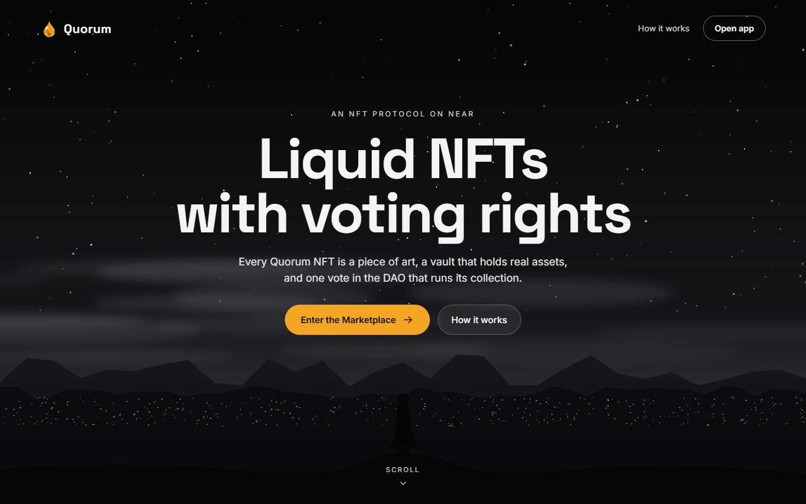
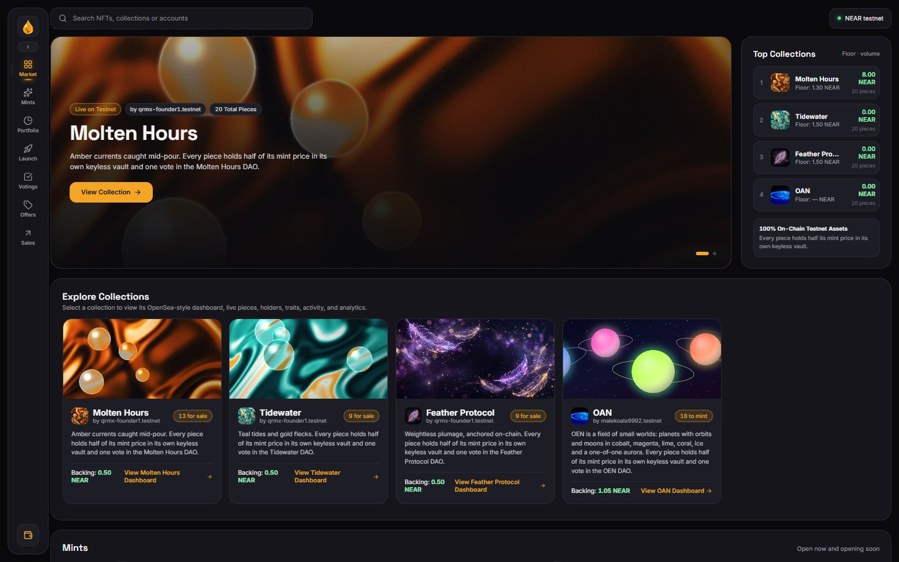
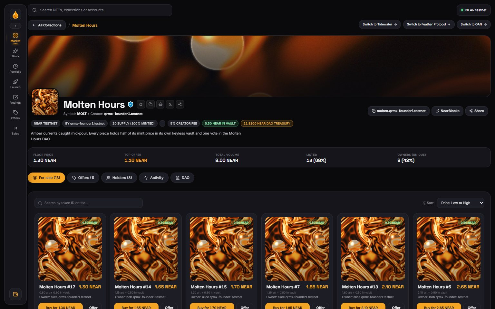
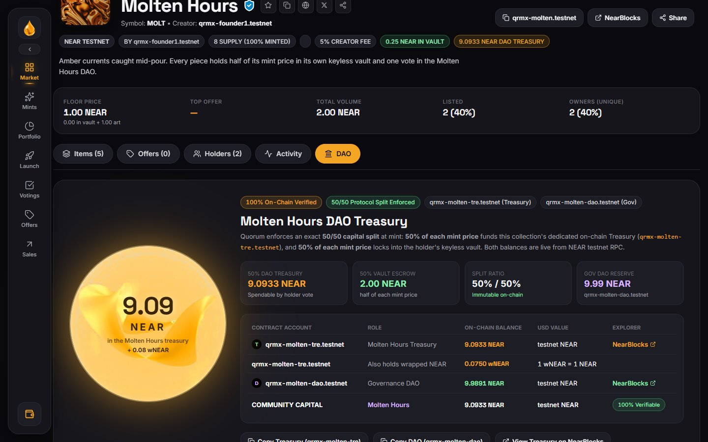
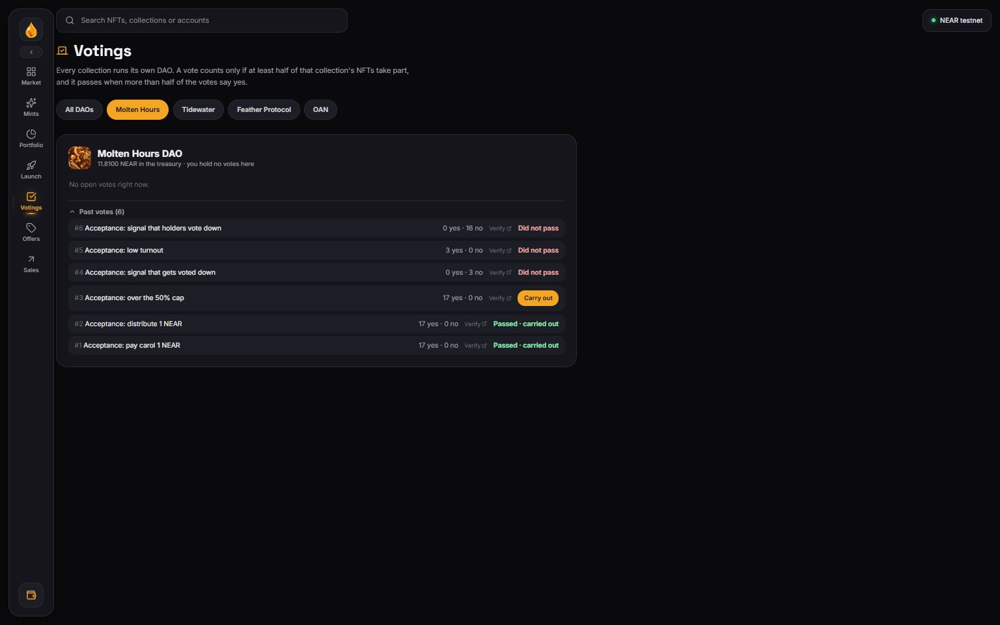
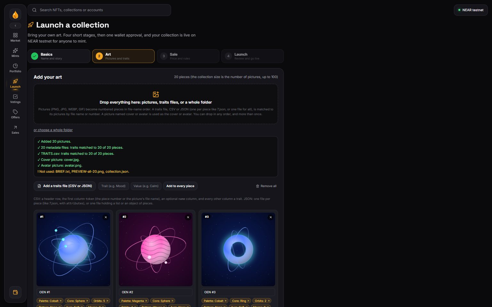
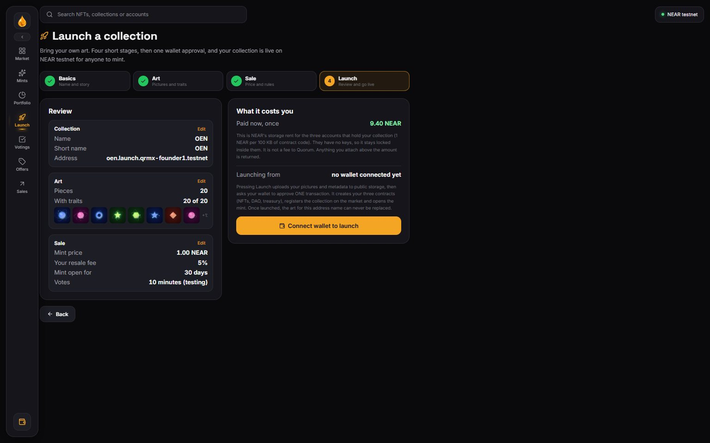

<p align="center">
  
</p>

<p align="center">
  <strong>Liquid NFTs with voting rights, on NEAR Protocol.</strong><br/>
  Every NFT is a piece of art, a keyless vault holding real assets, and one vote in the DAO that runs its collection.
</p>

<p align="center">
  <a href="https://quorumio.vercel.app"></a>
  <a href="https://www.rust-lang.org/"></a>
  <a href="#-test-suite"></a>
  <a href="#-no-mocks-every-number-comes-from-the-chain"></a>
  <a href="LICENSE"></a>
</p>

<p align="center">
  🌐 <a href="https://quorumio.vercel.app"><strong>quorumio.vercel.app</strong></a> (landing) &bull;
  <a href="https://quorumio.vercel.app/app"><strong>Open the app</strong></a> &bull;
  <a href="#-verify-it-yourself">Verify it yourself</a> &bull;
  <a href="#-live-testnet-deployments">Contracts</a> &bull;
  <a href="#-from-testnet-to-mainnet">Mainnet plan</a>
</p>

Submitted to the **NEAR Hackathon 2026** (Track: *NFTs That Do Something*).

---

## 📌 Executive Summary

Every Quorum NFT is three things at once:
1. **Art:** a NEP-171 token with NEP-177 metadata.
2. **A Vault:** its own keyless NEAR sub-account (`v<id>.<collection>`) that holds real backing assets. The holder can burn the NFT at any time and receive 90% of what the vault holds.
3. **A Vote:** exactly one vote in the DAO of that collection, which controls that collection's own treasury.

> **One collection, one DAO, one treasury.** There is no shared DAO and no pooled treasury. Each collection deploys its own NFT contract, DAO and treasury, and they are bound to each other when they are initialised: the DAO and treasury reject calls from any other collection. Votes and money never cross between collections.

> **Anyone can launch their own collection.** From the app's Launch page, with their own pictures and traits and one wallet approval, a creator gets their own keyless NFT, DAO and treasury, live on the market. See [Launch Your Own Collection](#-launch-your-own-collection-testnet-no-help-needed).

```
   ┌────────────────────────────────────────────────────────────────────────┐
   │                           QUORUM TRI-PRONG                             │
   │                                                                        │
   │       ┌──────────────┐     ┌──────────────┐     ┌──────────────┐       │
   │       │     ART      │     │    VAULT     │     │     VOTE     │       │
   │       │   NEP-171    │  +  │  Backing FT  │  +  │  1 Token =   │       │
   │       │   Metadata   │     │  Keyless A/C │     │    1 Vote    │       │
   │       └──────────────┘     └──────────────┘     └──────────────┘       │
   └────────────────────────────────────────────────────────────────────────┘
```

---

## 🟢 Live Usage: Proof the Platform Works

Quorum is not a mock-up. Four collections are live on NEAR testnet: three of 20 pieces launched by the team on 12 Nov 2026, and **OAN, launched by a user from the app's Launch page with their own art**. Every piece was minted through the normal public mint by real wallets, and real outside users have bought pieces. Snapshot read from the contracts on 13 Nov 2026 (the app always shows the current values):

| | Molten Hours | Tidewater | Feather Protocol | OAN (user-launched) | **Total** |
|---|---|---|---|---|---|
| Minted by the public mint | **20 / 20, sold out** | 15 / 20, mint open | 14 / 20, mint open | 2 / 20, mint open (2.1 NEAR each) | **51 / 80** |
| Burned and redeemed from their vaults | 1 | 1 | 2 | 0 | **4** |
| Unique holders | 8 | 8 | 7 | 1 | |
| For sale (cheapest first) | 13 (1.30 to 4.15 NEAR) | 9 (1.50 to 3.90) | 9 (1.50 to 3.95) | 0 | **31** |
| Top offer, NEAR escrowed on chain | 1.10 | 1.20 | 1.40 | none | |
| Market sales (5% to the DAO, 5% royalty, 90% seller) | 5 (8.0 NEAR) | 0 | 0 | 0 | **5 sales, 8.0 NEAR** |
| DAO proposals | 6: 2 executed, 3 failed, 1 passed but held back by the 50% spend cap | 0 | 0 | 0 | **6** |
| Treasury (live balance) | 11.81 NEAR + 0.05 wNEAR | 10.05 NEAR | 9.70 NEAR | 4.40 NEAR | **36.0 NEAR** |
| Vault backing | 10 wNEAR, settled with no vote | 7 NEAR in escrow until the mint ends | 6 NEAR in escrow until the mint ends | 2.1 NEAR in escrow until the mint ends | |

Treasuries are live account balances, so they include the 2.3 to 2.5 NEAR each account was opened with, the 50% of every mint, 5% of every sale and any donations (OAN's 4.40 is its 2.30 opening funds plus 2.10 from two mints). After Molten Hours sold out, an ordinary holder (not the DAO) converted its 10 NEAR escrow into exactly 10 wNEAR and filled the vaults, with no vote. Tidewater, Feather Protocol and OAN are still minting, so anyone with a testnet wallet can mint one in the app's **Mints** tab.
### Test editions: the full lifecycle

Before the launch, three smaller test editions of the same collections ran the whole lifecycle with real transactions: minting, trading, governing, settling and burning. They are still on chain and verifiable, but no longer shown in the app.

| | Molten Hours (test) | Tidewater (test) | Feather Protocol (test) | **Total** |
|---|---|---|---|---|
| NFTs minted (sold out) | 8 | 6 | 6 | **20** |
| Burned and redeemed from their vaults | 3 | 1 | 1 | **5** |
| Unique holders today | 2 | 3 | 2 | |
| Market sales (5% to the DAO, 5% royalty, 90% seller) | 2 | 1 | 0 | **3 sales, 2.7 NEAR** |
| Open listings | 3 | 1 | 2 | **6** |
| DAO proposals (executed / failed / passed, waiting) | 9 (4 / 5 / 0) | 4 (3 / 0 / 1) | 1 (1 / 0 / 0) | **14** (8 / 5 / 1) |
| Treasury balance | 9.09 NEAR + 0.08 wNEAR | 3.25 NEAR | 3.29 NEAR | **15.6 NEAR** |
| Settlement path exercised | DAO vote → wNEAR | escrow burn before settlement | permissionless NEAR fallback | |

Test-edition contracts: `qrmx-molten.testnet` / `qrmx-molten-dao.testnet` / `qrmx-molten-tre.testnet`, `qrmx-tide.testnet` / `tide-dao.qrmx-founder1.testnet` / `tide-tre.qrmx-founder1.testnet`, `feather.qrmx-founder1.testnet` / `feather-dao.qrmx-founder1.testnet` / `feather-tre.qrmx-founder1.testnet`. Their treasury balances are the real account balances, so they include test donations made with the treasury's `donate` method as well as the 50% mint share. Anyone can donate, and the app shows whatever the account actually holds.

### What has been done on chain

- ✅ **Mint:** staged mints. 50% of each price went to the collection treasury and 50% was locked in a new keyless vault.
- ✅ **Launch from the app:** a user's wallet created OAN with one transaction: three keyless accounts (NFTs, DAO, treasury), registered on the market, art uploaded by the user, mint open. Verify with `near account list-keys oan.launch.qrmx-founder1.testnet`: no keys.
- ✅ **Trade:** listings via NEP-178 approvals, purchases, and **on-chain offers** with NEAR escrowed by the market. Accepting an offer is one `nft_approve` transaction. A sale paid the seller exactly 1.35 NEAR, the DAO 0.075 and the creator 0.075 on a 1.5 NEAR price (checked in the receipts).
- ✅ **Govern:** spend, distribute, settle and text proposals were voted on with 1 NFT = 1 vote and executed after the timelock. A proposal with 85% turnout passed; one with 15% turnout failed even though every vote was yes; one with a majority of no failed; every tally matched the per-NFT vote records.
- ✅ **Spend cap:** a passed vote for 8 NEAR out of a 15 NEAR treasury was refused by the treasury (50% cap), the balance did not move, and the proposal stays retryable. A 1 NEAR vote paid exactly 1 NEAR.
- ✅ **Settle:** escrowed NEAR was converted to wNEAR, first by a DAO vote (test editions) and now, for wNEAR collections, by any account with no vote (live Molten Hours). Each vault was credited pro-rata by anyone, with no special permission. The no-DEX fallback was also exercised.
- ✅ **Distribute and claim:** 1 NEAR split equally (0.05 per NFT), reserved so it could not be spent elsewhere, and each claim worked exactly once.
- ✅ **Burn:** burning paid 90% of the backing to the holder and 10% to the treasury, both before and after settlement, plus the holder's unclaimed distribution.
- ✅ **Rejections:** every privileged method rejected the wrong caller, with a readable reason. See the [Test Suite](#-test-suite).

### Screens (live, testnet data)

| Marketplace | A collection's For sale tab, cheapest first | Collection DAO and treasury |
|---|---|---|
|  |  |  |

| Past votes, each verifiable | Launch: drop your art, it lines up | Launch: review before anything is sent |
|---|---|---|
|  |  |  |
---

## 🔍 No Mocks: Every Number Comes from the Chain

The web app has **no backend and no database**. Every figure is read from the contracts over NEAR RPC: supply, owners, listings, offers, floor price, volume, sales, proposals, vote tallies, treasury and vault balances. If the chain cannot be read, the app keeps showing the last data it read and says so after two failed refreshes in a row; it never invents a figure. Every transaction is signed in the user's wallet, and the app re-reads the chain afterwards to confirm it.

- **The marketplace shows only what is for sale**, cheapest first. A piece that is not listed is not on the market (its owner is still visible under Holders).
- **Floor price** shows both parts of an NFT's value: *art* (the listing price above the backing) and *backing* (the assets it can be burned for), labelled "in escrow" until the mint ends and "in vault" afterwards.
- **Treasury** figures are live account balances (NEAR + wNEAR), so donations appear immediately.
- **Mints** (the sidebar tab, and the strip on the Market page) are computed from each collection's on-chain mint stages. A new collection or stage appears on its own and nothing is listed by hand.
- **Collections launched from the app** are read from the factory contract's public list (`list_collections`), not from anything in the app's code.
- **Past votes** link to the DAO contract on NearBlocks, and the tallies match the per-NFT `has_voted` records (checked by `verify-votes.mjs` and `acceptance-2.mjs`).
- **The page does not twitch:** a refresh swaps data in place instead of rebuilding the page (measured on the live site: layout-shift score 0.002 over 75 seconds, page height constant).

What is off-chain: pictures and metadata files. The three launch collections' art is hosted with the app. Art for collections launched from the Launch page is uploaded to public Vercel Blob storage (a centralised host, fine for testnet; IPFS is the plan for mainnet) and is closed once the collection is launched. Also the optional indexer and API in `code/services/api`.

---

## 🔎 Verify It Yourself

**In the browser (2 minutes):**
1. Open **[quorumio.vercel.app/app](https://quorumio.vercel.app/app)** and connect a NEAR testnet wallet (Meteor{CONFIRMED} or others).
2. Open any collection, click **NearBlocks** on its header, and compare supply, owners and balances.
3. Open the **DAO** tab and compare the treasury figure with the treasury account on NearBlocks.
4. Buy a listed NFT, make an offer, or list one of yours. Every action is a real testnet transaction.

**From the command line** ([near-cli-rs](https://github.com/near/near-cli-rs)):

```bash
# A vault has no access keys at all: nobody can move its assets except the burn path
near account list-keys v1.molten.qrmx-founder1.testnet network-config testnet now

# Every proposal of the Molten Hours test-edition DAO, with tallies (the full voting history)
near contract call-function as-read-only qrmx-molten-dao.testnet list_proposals \
  json-args '{"from_id":0,"limit":20}' network-config testnet now

# On-chain sale log of the market (price, 5% pool fee, royalty, seller net)
near contract call-function as-read-only market.qrmx-founder1.testnet recent_sales \
  json-args '{"nft":null,"limit":20}' network-config testnet now

# Live treasury balance
near account view-account-summary molten-tre.qrmx-founder1.testnet network-config testnet now

# Collections launched from the app, straight from the factory
near contract call-function as-read-only launch.qrmx-founder1.testnet list_collections \
  json-args '{"from_index":0,"limit":20}' network-config testnet now

# A collection made by the factory has no access keys at all (OAN, launched by a user)
near account list-keys oan.launch.qrmx-founder1.testnet network-config testnet now
```

**Without any tools:**

```bash
curl -s https://rpc.testnet.near.org -H 'content-type: application/json' -d '{"jsonrpc":"2.0","id":1,"method":"query","params":{"request_type":"view_access_key_list","finality":"final","account_id":"v1.molten.qrmx-founder1.testnet"}}'
# → "keys": []
```

---

## 💎 Live Testnet Deployments

The live collections: three launched by the team on 12 Nov 2026 with 20 pieces each, and every collection launched from the app (listed in the factory registry, for example OAN below). All figures in the app are read from these contracts.

| Collection | NFT contract | DAO | Treasury |
|---|---|---|---|
| Molten Hours | [`molten.qrmx-founder1.testnet`](https://testnet.nearblocks.io/address/molten.qrmx-founder1.testnet) | [`molten-dao.qrmx-founder1.testnet`](https://testnet.nearblocks.io/address/molten-dao.qrmx-founder1.testnet) | [`molten-tre.qrmx-founder1.testnet`](https://testnet.nearblocks.io/address/molten-tre.qrmx-founder1.testnet) |
| Tidewater | [`tidewater.qrmx-founder1.testnet`](https://testnet.nearblocks.io/address/tidewater.qrmx-founder1.testnet) | [`tidewater-dao.qrmx-founder1.testnet`](https://testnet.nearblocks.io/address/tidewater-dao.qrmx-founder1.testnet) | [`tidewater-tre.qrmx-founder1.testnet`](https://testnet.nearblocks.io/address/tidewater-tre.qrmx-founder1.testnet) |
| Feather Protocol | [`feather-protocol.qrmx-founder1.testnet`](https://testnet.nearblocks.io/address/feather-protocol.qrmx-founder1.testnet) | [`feather-protocol-dao.qrmx-founder1.testnet`](https://testnet.nearblocks.io/address/feather-protocol-dao.qrmx-founder1.testnet) | [`feather-protocol-tre.qrmx-founder1.testnet`](https://testnet.nearblocks.io/address/feather-protocol-tre.qrmx-founder1.testnet) |
| OAN (launched from the app) | [`oan.launch.qrmx-founder1.testnet`](https://testnet.nearblocks.io/address/oan.launch.qrmx-founder1.testnet) | [`oan-dao.launch.qrmx-founder1.testnet`](https://testnet.nearblocks.io/address/oan-dao.launch.qrmx-founder1.testnet) | [`oan-tre.launch.qrmx-founder1.testnet`](https://testnet.nearblocks.io/address/oan-tre.launch.qrmx-founder1.testnet) |

| Shared | Account |
|---|---|
| Market | [`market.qrmx-founder1.testnet`](https://testnet.nearblocks.io/address/market.qrmx-founder1.testnet): only registered collections can list (registered by the owner or by the factory), and the owner cannot move anyone's funds |
| Collection factory | [`launch.qrmx-founder1.testnet`](https://testnet.nearblocks.io/address/launch.qrmx-founder1.testnet): the Launch page calls it; every collection it creates (`<name>.launch.qrmx-founder1.testnet`, `-dao`, `-tre`) has **zero access keys** |
| Vault code | NEP-591 global contract, hash `DQALgt8fazwvRPFKdz2j5Eek9kacchwFm2vCucLDPCn8` |
| Vaults | `v<id>.<nft contract>`, **zero access keys** (e.g. [`v1.molten.qrmx-founder1.testnet`](https://testnet.nearblocks.io/address/v1.molten.qrmx-founder1.testnet)) |

**DAO rules enforced by the contract** (not by the UI):
- **Turnout:** at least **50% of all NFTs** must vote, and **more than half** of the votes must be yes. The 50% turnout floor is hard-coded in the DAO, so no founder setting can lower it.
- **Spend cap:** a single treasury spend may not exceed **50% of the treasury's free funds**. Amounts reserved for holder distributions can never be spent.
- **One vote per token:** a token that changed hands after a proposal opened cannot vote on it, which stops flash-loan voting.
- **Timing:** founder-set floors on voting period, pass threshold and timelock. The voting period is capped at 30 days, and a passed proposal expires if it is not executed within 14 days of its timelock.

DAO voting periods on these demo deployments are **10 minutes**, so a judge can watch a proposal go from creation to execution. Production collections should use 3–5 day periods. Proposals executed before the 50% turnout rule was added keep their recorded outcome. Those that had passed but were not yet executed (Molten #1 and #2) now read as failed.

---

## 🔄 How the Money Moves

| Stage | Mechanism | Details |
|---|---|---|
| **1. Mint** | Staged allowlist / public | The buyer pays the stage price plus 0.03 NEAR storage. **50% goes to the collection's treasury immediately**, and **50% is locked as backing** for the new token's keyless vault. |
| **2. Sovereign DAO** | 1 NFT = 1 vote | Only holders of that collection vote on its treasury. There is no cross-collection voting or pooling. |
| **3. Asset Plan** | Deterministic round-robin | Fixed at launch (e.g. `wNEAR:1` or `USDC:2, wNEAR:1`). Assignment is immutable and nobody can choose which asset a token gets. |
| **4. Settlement** | Automatic for wNEAR, vote for DEX swaps | Once the mint is over, the escrow is converted into the asset fixed at launch. **wNEAR converts 1:1, so anyone can trigger it with no vote** (this is what the live collections use, via `wrap.testnet`). An asset that needs a DEX swap (e.g. USDC through **Rhea Finance** on mainnet) is approved by a holder `SETTLE` vote with a mandatory `min_out`. If a group is not settled within the grace period, **anyone** can switch it to plain NEAR. |
| **5. Crediting** | Permissionless batching | Anyone can call `credit_batch` (up to 3 NFTs per transaction) to push pro-rata shares into vaults. 256-bit `mul_div` prevents overflow. |
| **6. Burn to Redeem** | Guaranteed floor | Burning pays **90% of the backing to the holder** and **10% to the treasury**. Before settlement it pays from escrow in NEAR, and after settlement from the vault in the plan's tokens. |
| **7. Marketplace** | Listings and offers | Fixed-price sales via NEP-178 approvals, and offers with NEAR escrowed by the market. Each sale sends **5% to the collection's treasury**, the royalty to the creator, and the rest to the seller. The vault travels with the token. |
| **8. Distributions** | O(1) dividend | The treasury pays all holders through a reward index, so gas is constant whatever the supply. |

---

## 📦 Smart Contracts

All contracts are in [`code/contracts/`](code/contracts/) and use `near-sdk = "=5.30.1"`.

```
code/contracts/
├── common/         # Fee constants, 256-bit mul_div, asset validation, events, Rhea message builder
├── vault/          # NEP-591 global contract, deployed by hash to keyless sub-accounts
├── nft/            # NEP-171/177/178/181 collection, escrow, settlement, burn, vote gate
├── treasury/       # Collection treasury: spends, distributions, reward index, donations
├── dao/            # Proposals, 1-token-1-vote tally, 50% turnout, bounds, timelock, expiry
├── market/         # Listings, offers (escrowed), fee split, on-chain sale log and stats
└── factory/        # Self-serve launches: creates a collection's NFT, DAO and treasury as keyless accounts
```

| Contract | Highlights |
|---|---|
| `quorum-common` | `MINT_VAULT_BPS = 5000` (50%), `SALE_POOL_BPS = 500` (5%), `REDEEM_POOL_BPS = 1000` (10%). 256-bit `mul_div`. The Rhea swap builder requires a positive `min_amount_out`. Assets are restricted to `near` or a valid `nep141:<account>`. |
| `quorum-vault` | Keyless `v<token_id>.<collection>`. It has no withdraw method. It accepts deposits only through the verified owner or the collection, and redeems only on a verified burn. |
| `quorum-nft` | NEP-171/177/178/181/297. Staged Merkle allowlists, wallet quotas and a supply cap. Settlement checks the balance before and after and requires `min_out`. A wNEAR group can be settled by anyone once the mint is over; a DEX group only by the DAO. The vote gate checks `last_transfer_block < proposal.start_block`. |
| `quorum-treasury` | Pays out only through executed DAO proposals, with a 50% single-spend cap. The reward index is scaled by 10⁹ with `mul_div`, which fixed an overflow the live tests found. Anyone can `donate`. |
| `quorum-dao` | Proposal kinds: `Spend`, `Distribute`, `ParameterChange`, `Settle`, `Swap`, `Text`. The 50% turnout floor is hard-coded. Multi-token votes are all-or-nothing (`record_votes`). Execution is permissionless after the timelock and can be retried if it fails. |
| `quorum-factory` | Self-serve launches. One call creates a collection's NFT, DAO and treasury as sub-accounts, loads the Quorum contract code embedded in the factory (so only the real contracts can ever run), initialises them and registers the collection on the market, **without adding any access key**. The creator pays the storage and becomes the founder and resale-fee recipient. It has no owner and no admin method, and it keeps a public list of every collection it created, which the app reads. |
| `quorum-market` | Listings and offers on the same contract. Buyers must supply the `approval_id`, which defeats front-running. Offers escrow NEAR, can be withdrawn by the buyer, and are refunded on expiry. Sales are recorded on chain (`recent_sales`, `get_stats`), and the state migrated in place with no data lost. |

---

## 🛠️ NEAR Tools & Technologies (How We Used Them)

| NEAR Tool / Standard | Role in Quorum |
|---|---|
| **`near-sdk` (Rust 5.30.1)** | All seven contracts. Cross-contract promises are written so that no callback returns a joint promise (a NEAR runtime rule the live tests surfaced). |
| **Keyless accounts** | Each per-NFT vault is created without any access key, so its assets can only leave through a burn executed by the collection contract. |
| **NEP-591 (global contract by hash)** | The vault bytecode is published once. Each new vault references it by hash instead of paying for its own copy. |
| **NEP-171 / 177 / 178 / 181** | Tokens, metadata, approvals (market listings *and* one-click offer acceptance), and enumeration (the app lists every piece from the chain). |
| **NEP-297 events** | `mint`, `burn`, `transfer`, `treasury_donation`, `treasury_spend` … for indexers. |
| **NEP-141 (wNEAR / FTs)** | Vault assets after settlement. Storage registration is handled before transfers, including for burners' wallets. |
| **NEP-413** | Signed-message login for holder-only routes in the optional API service (`code/services/api`). |
| **`near-cli-rs`** | Builds, account creation, keyless deployments and per-collection deploy scripts (`code/scripts/`). |
| **`near-api-js`** | The live end-to-end test suite (`code/scripts/e2e/`) signs and checks real transactions. |
| **NEAR Connect** (`@hot-labs/near-connect`) | Wallet connection (Meteor, HOT, MyNearWallet and others) with testnet signing. |
| **Multi-provider RPC** | dRPC → FastNear → rpc.testnet.near.org, with a short view cache, a concurrency limit and automatic fallback on rate limits. |
| **Sub-accounts and embedded code** | The collection factory creates each collection's three accounts, loads the Quorum contract code that is embedded in the factory itself (so only the real contracts can ever run) and initialises them in one batch, with no access key added. |
| **Vercel Blob (off-chain, for art only)** | Public storage for the pictures and metadata creators upload on the Launch page, behind an endpoint that allows only pictures and metadata in the right place and closes a collection name once it is launched. |

---

## ⚡ Scalability & Sharded Architecture

| Challenge | Quorum's Answer |
|---|---|
| **Storage per vault** | The vault contract is a NEP-591 global contract, so each vault account references the code by hash instead of storing its own copy. |
| **Sharding** | Each vault is its own account, so deposits and redemptions spread across shards instead of queueing on one contract. |
| **Distributions** | A per-asset accumulator index means each NFT computes its share on claim: O(1) gas, not O(holders). |
| **Bounded execution** | At most 9 asset types, 15 votes per vote transaction, and 3 vault credits per call. There are no unbounded loops. |
| **Front-end load** | The first load shows all collections together, every later refresh swaps data in place (nothing disappears and reappears), per-page data loads only when that page opens, and code is split by page. First content appears in about 3 seconds from a cold start. Rows of collections and tabs scroll sideways instead of squeezing when more are added. |

---

## 🛡️ Security Model & Invariants

### Trust Boundaries

```
┌───────────┬───────────────────────────────────┬────────────────────────────────────────┐
│ Actor     │ Permitted Capabilities            │ Prohibited Actions                     │
├───────────┼───────────────────────────────────┼────────────────────────────────────────┤
│ Vault     │ Receive assets, execute burn-out  │ Move funds without collection burning  │
│ Treasury  │ Execute passed DAO proposals      │ Move funds without DAO authorization   │
│ Founder   │ Lower the royalty (only lower)    │ Pause a mint, change vault code,       │
│           │                                   │ alter asset plan, touch vaults/funds   │
│ DAO       │ Parameter updates, spends, swaps  │ Override fee splits or asset plan      │
│ Market    │ Settle sales and offers           │ Move escrow except to buyer or seller  │
└───────────┴───────────────────────────────────┴────────────────────────────────────────┘
Mint timing comes only from the stage times fixed at launch, and a collection cannot launch paused. Only a holder vote
(through the DAO) can pause a mint, as an emergency brake.
```

### 9-Point Transfer Threat Model

1. **Keep a vault key:** impossible. The vault account is created keyless in the same batch as `new()`.
2. **Withdraw before selling:** the vault has no withdraw or transfer method.
3. **Burn right after selling:** `burn_and_redeem` reads current on-chain ownership and pays the current owner.
4. **Claim old distributions after a sale:** distributions stay with the token, so they pass to the buyer.
5. **Vote after selling:** a transfer updates `last_transfer_block`, and the DAO refuses that token on proposals opened before the transfer.
6. **Deposit phantom assets:** only deposits through the `can_deposit` ledger count as backing.
7. **Mint, sell, and collect the escrow:** the escrow belongs to the token, not to the original minter.
8. **Double crediting:** `credited = true` is set before the transfer and reset if the transfer fails, so the credit can be retried.
9. **Off-market sales:** allowed. The vault travels with the token anyway.

### Launching and uploads

- **The factory has no owner and no admin method.** Its settings (market, vault code, DEX, wNEAR) are fixed when it is created, and the contract code it deploys is embedded in it, so a launched collection can only run the real Quorum contracts.
- **A launched collection has no access keys.** Nobody, including the creator and the team, can change its code or take its funds outside its rules. The creator is its founder and fee recipient, and the founder can only lower the royalty.
- **A launch is checked before it is sent:** name, address name, supply (1 to 500), price, fee (at most 90%), mint days and https art links are validated by the contract, and the generated settings are unit-tested against the real NFT, DAO and treasury constructors. A refused launch costs only gas, and a failed creation returns the funding of any account that did not come up.
- **Uploads are narrow.** The upload endpoint accepts only pictures (3 MB, PNG, JPG, WEBP, GIF) and metadata JSON (20 KB) at fixed paths for pieces 1 to 100, refuses reserved names and any name already launched (so art can never be replaced), and the storage token never leaves the server.

---

## 🧪 Test Suite

Two layers. The second exists because unit tests alone missed real bugs.

1. **154 Rust unit tests** across the seven crates (`cargo test --workspace`): common 14, DAO 23, factory 8, market 28, NFT 43, treasury 21, vault 17. The factory's generated settings are checked against the real NFT, DAO and treasury constructors.
2. **Live NEAR testnet end-to-end tests** in `code/scripts/e2e/`. They send real transactions to the deployed contracts and assert on the resulting chain state, down to the yocto where the contract is exact. Coverage includes the mint split, vault keylessness, transfers, listings, offers and sales, proposals and votes, execution and settlement, crediting, distributions, claims and burns. There is also a negative test for every access rule.

**Bugs only the live tests found** (all fixed and redeployed; details in [code/docs/TESTING.md](code/docs/TESTING.md)):

| Bug | Effect |
|---|---|
| Market callback returned a joint promise | The NFT moved but nobody was paid |
| Multi-token `vote` and `credit_batch` | Any batch of more than one token failed |
| Reward index scaled by 10²⁴ | Every distribution above ~0.0000003 NEAR overflowed |
| wNEAR registration fee | The last vault credit came up short |
| Burn before settlement | Owner deposits in the vault were locked forever |
| Settlement accepted any balance increase | A dust donation could fake a swap |
| A regular expression lost its backslashes in the UI | The floor price always showed "0.00 in vault" (found by a manual check, then fixed) |
| The drop reader fell back to list position | A JSON entry whose own token matched no picture was attached to piece 1 (found by its test, then fixed) |
| A background refresh emptied the collection list | The page jumped every 30 seconds (found by measuring layout shift, then fixed) |

```bash
# Rust contract unit tests
cd code && cargo test --workspace

# Live testnet end-to-end (needs funded testnet accounts; keys live outside the repo in ~/.quorum-keys)
cd code
node scripts/e2e/molten-1b.mjs      # access control, sale payouts, governance rules, votes
node scripts/e2e/molten-2.mjs       # execute, settle, credit, distribute, burn
node scripts/e2e/tide.mjs           # per-collection isolation, pre-settlement burn, full proposal
node scripts/e2e/feather.mjs        # permissionless fallback settlement
node scripts/e2e/offers.mjs         # escrowed offers, withdraw, one-transaction accept
node scripts/e2e/dao-standards.mjs  # list_proposals, 30-day cap, 50% spend cap
node scripts/e2e/verify-votes.mjs   # every tally matches the per-NFT vote records
node scripts/e2e/settle-open.mjs    # a wNEAR collection settles with no vote; anyone fills the vaults
node scripts/e2e/founder-locked.mjs # the founder cannot pause a mint or change the vault code
node scripts/e2e/factory-check.mjs   # a plain wallet launches a collection in one call: keyless, bound, registered, mintable
node scripts/e2e/acceptance-1.mjs && node scripts/e2e/acceptance-1b.mjs && node scripts/e2e/acceptance-2.mjs   # sales, offers, DAO rules, distributions, burns on the live collections

# The Launch page: art upload rules, the drop-everything reader, and the page's own upload code (live)
cd ../frontend
node scripts/upload-check.mjs                            # allowed files go through, everything else is refused
node scripts/ingest-check.ts                             # a whole folder, 0- and 1-based JSON, CSV, traits before pictures
node --env-file=.env.local scripts/art-flow-check.ts     # the exact links the NFT contract fetches
```

---

## 🧑‍🎨 Launch Your Own Collection (testnet, no help needed)

Anyone can launch a collection from the **Launch** page, with their own art, on NEAR testnet. The page walks through four stages (**Basics, Art, Sale, Launch**) with a progress bar and Back and Next buttons. Next stays disabled, with the reason shown, until a stage is complete, and the last stage is a review of everything before anything is sent.

1. **Basics:** name, short name, address name (checked live for availability) and a description.
2. **Art, in one drop:** drop your pictures (PNG, JPG, WEBP, GIF, up to 100), your traits files, or a whole folder. The page reads it and lines it up:
   - pictures become numbered pieces in file-name order;
   - a picture named `cover` or `avatar` becomes the cover or avatar;
   - traits files are matched to their pictures by file name, then by number (0-based and 1-based both work). Traits can be a CSV (first column `token`, an optional `name` column, every other column a trait), one JSON file per piece (`7.json` with `attributes`, the usual OpenSea shape), or one JSON file holding a list or an object of pieces;
   - files can come in any order and in several drops (traits dropped before the pictures are remembered), and anything it cannot use is listed instead of silently ignored.

   You can then rename pieces, add or remove traits by hand, or add a trait to every piece at once.
3. **Sale:** price, your resale fee, how long the mint stays open, and whether votes are short (testing) or standard.
4. **Launch:** review, press Launch and approve **one** transaction in your wallet.

What happens: the app uploads the pictures and metadata to public storage, then the wallet calls the collection factory once. It creates the NFT, DAO and treasury as **keyless** accounts (nobody can change them), registers the collection on the market and opens the mint. The collection then appears in the app for everyone, with each piece's own picture and traits. The creator becomes the founder and receives the resale fee. Once a collection name is launched its art is closed and can never be replaced.

**What it costs the creator:** NEAR's storage rent for the three accounts, about 9.4 NEAR for 20 pieces, paid once and locked inside them (NEAR charges 1 NEAR per 100 KB of stored code). It is not a fee to Quorum. On mainnet this drops to under 1 NEAR by publishing the NFT, DAO and treasury code once as NEP-591 global contracts, the way the vault already works (a one-time publish of roughly 80 NEAR for the platform).

---
## 🚀 From Testnet to Mainnet

The contracts are the same on both networks. What changes is configuration.

| | Testnet today | Mainnet |
|---|---|---|
| Settlement asset route | `wrap.testnet` (no DEX liquidity on testnet) | **Rhea Finance** pools with enforced `min_out` |
| Asset plan | `wrap.testnet:1` | e.g. `USDC:2, wrap.near:1` |
| DAO voting period | 10 minutes (demo) | 3–5 days |
| Accounts | `qrmx-*.testnet`, `*.qrmx-founder1.testnet` | `<collection>.near`, `dao-<collection>.near`, `tre-<collection>.near` |
| Market | `market.qrmx-founder1.testnet` | one shared mainnet market account |
| Launching a collection | factory, creator pays about 9.4 NEAR of storage rent for 20 pieces | factory with the NFT, DAO and treasury code published once as NEP-591 global contracts, so a launch costs the creator under 1 NEAR |
| Art hosting | Vercel Blob (public storage) | IPFS or another content-addressed store |
| RPC | dRPC / FastNear testnet | mainnet RPC providers |

### Mainnet Runbook

1. **Build and optimise:** `cargo build --target wasm32-unknown-unknown --release`, then `wasm-opt -Oz`.
2. **Fund the founder account** on mainnet (`you.near`).
3. **Publish the vault code once** as a NEP-591 global contract and note its hash.
4. **Deploy the collection factory** (and appoint it a registrar on the market), so creators can launch their own keyless collections. The team's own collections can be deployed the same way, or with `code/scripts/deploy-collection.sh`.
5. **Configure settlement** for Rhea Finance routes, with `min_out` slippage limits on every `SETTLE` proposal.
6. **Delete the access keys** of the NFT, DAO, treasury and market accounts, then verify with `near account list-keys`.
7. **Rehearse on the live deployment:** credit vaults (`credit_batch`), burn one token, and confirm the 90 / 10 split.
8. **Open the public mint.**

```bash
cd code
NETWORK=mainnet CONFIRM_MAINNET=yes \
FOUNDER=youraccount.near PREFIX=quorum1 \
ASSET_PLAN="17208628f84f5d6ad33f0da3bbbeb27ffcb398eac501a31bd6ad2011e36133a1:2,wrap.near:1" \
./scripts/deploy.sh
```

---

## 🧰 Quickstart

### Prerequisites
- [Rust](https://rustup.rs/) with the `wasm32-unknown-unknown` target
- [Node.js](https://nodejs.org/) v22+
- [near-cli-rs](https://github.com/near/near-cli-rs)
- [Docker](https://www.docker.com/) (only for the optional API service)

### 1. Build the contracts
```bash
cd code
cargo build --workspace --target wasm32-unknown-unknown --release
```

### 2. Deploy to testnet
```bash
cd code
FOUNDER=youraccount.testnet PREFIX=quorum1 \
ASSET_PLAN="wrap.testnet:1" WRAP=wrap.testnet \
./scripts/deploy.sh
```

### 3. Run the web app
```bash
cd frontend
npm install
npm run dev
```
Open [http://127.0.0.1:3000](http://127.0.0.1:3000). The landing page is at `/` and the app is at `/app`. The app has Market, Mints, Portfolio, Launch, Votings, Offers and Sales. The three launch collections are in `frontend/src/deployments.ts`; every collection launched through the factory is read from the factory contract and appears by itself.

The Launch page uploads art through `frontend/api/blob.js`, which needs a Vercel Blob store (`vercel blob create-store quorum-art --access public`, which sets `BLOB_READ_WRITE_TOKEN`; it is git-ignored in `frontend/.env.local`). `npm run dev` serves the app but not `/api`, so use `vercel dev` locally, or deploy with `vercel --prod`.

### 4. Optional: indexer and REST API
```bash
cd code/services/api
cp .env.example .env   # set COLLECTION, DAO, TREASURY, MARKET
docker compose up --build
```

<details>
<summary><strong>REST API endpoints</strong> (port 8080)</summary>

```
GET   /health                          # Indexer sync cursor & health
GET   /nfts                            # Paginated live NFTs (filter by ?owner=, ?listed=true)
GET   /nfts/:id                        # Token metadata, backing vault balances, votes cast
GET   /nfts/:id/history                # Ownership, yields, payouts
GET   /metadata/:id.json               # NEP-177 metadata with live vault attributes
GET   /settlement                      # Group swap phases, total escrow, uncredited token IDs
GET   /mint/proof?stage=0&account=..   # Merkle allowlist proof for presale minting
GET   /market/listings                 # Active marketplace listings
GET   /market/sales                    # Sale history
GET   /dao/proposals                   # DAO proposals with tallies
GET   /treasury                        # Inflows, outflows, distributions, reserves
POST  /auth/challenge                  # Holder NEP-413 login challenge
POST  /auth/verify                     # Verify Ed25519 signature & issue session token
GET   /gated/me                        # Holder-only portal (re-checks NFT balance)
GET   /gated/members                   # Token-gated member directory
```
</details>

---

## 🗺️ Roadmap

- [x] **Phase 1: Core protocol and self-serve launches (NEAR Hackathon 2026)**
  - 7 Rust contracts on `near-sdk 5.30.1`, 154 unit tests, live testnet end-to-end and browser checks
  - Keyless per-NFT vaults on a NEP-591 global contract
  - Per-collection DAO and treasury: 50% turnout, 50% spend cap, timelock and expiry
  - wNEAR collections settle with no vote; DEX assets settle by holder vote with a minimum price
  - Market with listings, escrowed offers and an on-chain sale log
  - Collection factory live: anyone launches their own keyless collection from the Launch page, with their own art and traits, in one wallet transaction
  - Four live collections, one launched by a user from the app, after test editions ran the full lifecycle: minted, traded, governed, settled and burned
  - Web app reading 100% from chain, plus an optional Neardata indexer and NEP-413 API
- [ ] **Phase 2: Mainnet and cheaper launches**
  - Mainnet launch with Rhea settlement
  - NFT, DAO and treasury code as NEP-591 global contracts, cutting a launch from about 9.4 NEAR to under 1 NEAR
  - Code upgrades for keyless collections by holder vote only (the DAO approves a code hash, anyone submits the matching code)
  - IPFS for art, keeper bots for permissionless vault crediting
  - Dutch and English auctions, delayed reveals with provenance
- [ ] **Phase 3: Privacy & advanced liquidity**
  - Sealed-bid auctions and private OTC transfers
  - Rhea concentrated-liquidity support
  - TEE-managed keeper keys via Shade Agents

---
## 📄 License

Licensed under the [MIT License](LICENSE).
Built with ❤️ for the NEAR Protocol Ecosystem.
