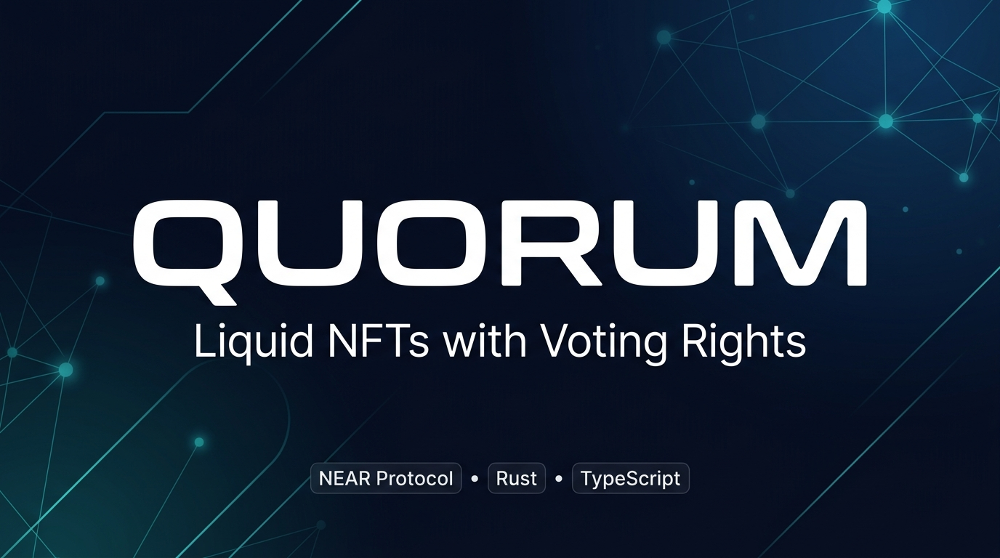
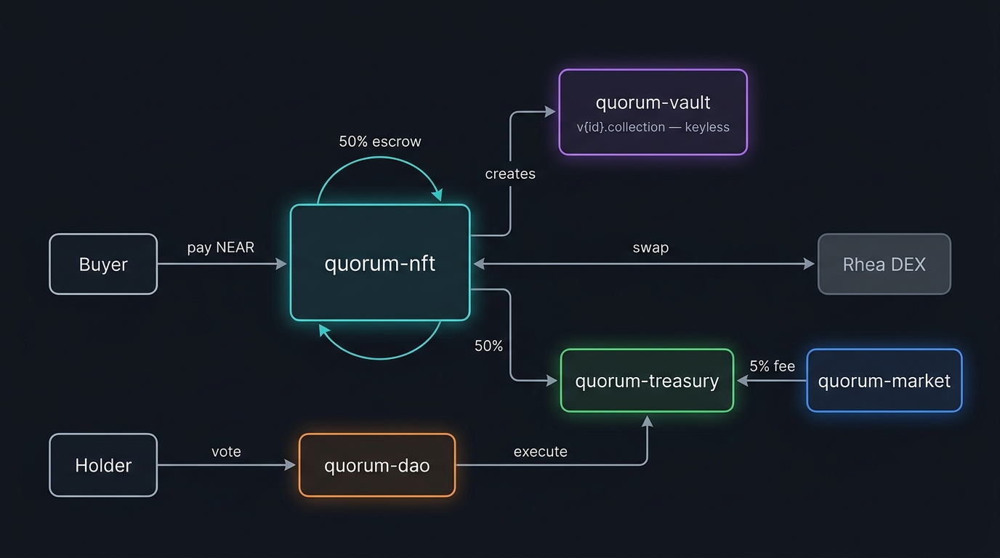
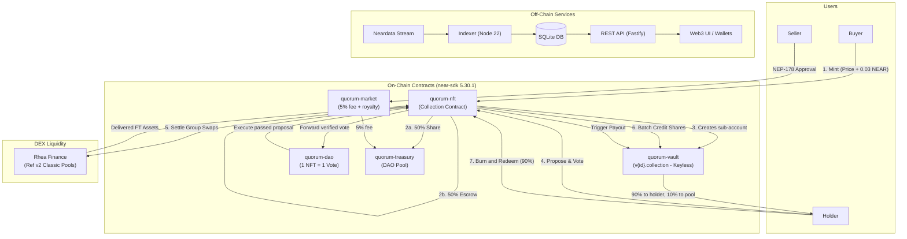

<p align="center">
  
</p>

<p align="center">
  <strong>Liquid NFTs with voting rights, on NEAR Protocol.</strong>
</p>

<p align="center">
  <a href="https://near.org"></a>
  <a href="https://www.rust-lang.org/"></a>
  <a href="https://nodejs.org/"></a>
  <a href="https://fastify.dev/"></a>
  <a href="#test-suite"></a>
  <a href="LICENSE"></a>
</p>

---

## 📌 Executive Summary

Every Quorum NFT is three things simultaneously:
1. **Art:** A NEP-171 non-fungible token carrying unique traits and high-fidelity visuals.
2. **A Vault:** An independent, keyless NEAR sub-account (`v<id>.<collection>`) holding real backing assets (USDC, wNEAR, etc.). Holders can withdraw 90% of backing at any time by burning the NFT.
3. **A Vote:** Exactly one live vote per token in the decentralized autonomous organization (DAO) controlling the collection's shared treasury and settlement parameters.

Submitted to the **NEAR Hackathon 2026** (Track: *NFTs That Do Something*).

```
   ┌────────────────────────────────────────────────────────────────────────┐
   │                           QUORUM TRI-PRONG                             │
   │                                                                        │
   │       ┌──────────────┐     ┌──────────────┐     ┌──────────────┐       │
   │       │     ART      │     │    VAULT     │     │     VOTE     │       │
   │       │   NEP-171    │  +  │  Backing FT  │  +  │  1 Token =   │       │
   │       │   Metadata   │     │  Keyless A/C │     │    1 Vote    │       │
   │       └──────────────┘     └──────────────┘     └──────────────┘       │
   └────────────────────────────────────────────────────────────────────────┘
```

---

## 🏗️ Architecture

<p align="center">
  
</p>

### System Topology



---

## 🔄 How the Money Moves

| Stage | Mechanism | Details |
|---|---|---|
| **1. Mint** | Staged Allowlist / Public | Buyer attaches stage price in NEAR + 0.03 NEAR storage. **50% transfers to DAO Treasury immediately**. **50% remains in collection escrow** backing that NFT. |
| **2. Asset Plan** | Deterministic Round-Robin | Fixed at launch (e.g. `USDC:2, wNEAR:1`). Token #1 and #2 carry USDC, #3 carries wNEAR. Immutable; no party can manipulate assignment. |
| **3. Settlement** | DEX Conversion via Rhea | Once mint closes, holders vote on a `SETTLE` proposal containing swap route and slippage protection (`min_out`). Quorum swaps escrowed NEAR through Rhea (Ref classic pools). |
| **4. Crediting** | Permissionless Batching | Anyone calls `credit_batch` (up to 3 NFTs per tx) to push pro-rata asset shares into individual vaults. 256-bit arithmetic prevents overflow. |
| **5. Fallback** | Guarantee against Stagnation | If no swap proposal executes before `settle_grace_ms` (14 days), anyone triggers `enable_fallback` to credit plain NEAR. Funds are never trapped. |
| **6. Burn to Redeem** | Guaranteed Floor Price | Burn pays **90% of backing to holder** and **10% to DAO treasury**. Pre-settlement: paid from escrow in NEAR. Post-settlement: paid from vault in FTs. |
| **7. Marketplace** | Non-Custodial Trading | Fixed-price sales via NEP-178 approvals. Sends 5% fee to DAO treasury, royalty to creator, remainder to seller. Vault custody transitions automatically. |
| **8. Distributions** | $O(1)$ Scalable Dividend | Treasury executes even holder distributions via a global reward index. Gas is constant regardless of total NFT supply. |

---

## 🎨 Generative Art Gallery

Quorum features six original generative artwork collections created specifically for the platform:

| Collection | Preview | Asset Backing | Weight |
|---|---|---|---|
| **Tidewater** |   | `wrap.near` (wNEAR) | 3 |
| **Molten** |   | `172086...` (USDC) | 2 |
| **Orchard** |   | `usdt.tether-token.near` | 2 |
| **Nocturne** |   | `aurora` | 1 |
| **Saltlight** |   | `wrap.near` (wNEAR) | 2 |
| **Currents** |   | `172086...` (USDC) | 2 |

### Collection Hero Banners

<p align="center">
  
  
  
</p>

---

## 🖥️ UI & Experience Artboards

Eight end-to-end design artboards are provided in `design/artboards/`:

| Screen | File | Description |
|---|---|---|
| **Landing** | [`Launch.dc.html`](design/artboards/Launch.dc.html) | Night-scene atmospheric landing page showcasing the Quorum value proposition |
| **Marketplace** | [`Marketplace.dc.html`](design/artboards/Marketplace.dc.html) | Live drop countdowns, trending vaults, floor prices, secondary listings |
| **Main View** | [`Main.dc.html`](design/artboards/Main.dc.html) | Master overview of user balances, treasury reserves, active proposals |
| **Minting** | [`Mint.dc.html`](design/artboards/Mint.dc.html) | Staged mint modal with Merkle allowlist verification & transparent vault breakdown |
| **Portfolio** | [`Portfolio.dc.html`](design/artboards/Portfolio.dc.html) | Holder dashboard: redeem floor value, claimable distributions, voting power |
| **Governance** | [`Votings.dc.html`](design/artboards/Votings.dc.html) | DAO proposal portal: quorum tracker, live tallies, timelock indicators |
| **Offers** | [`Offers.dc.html`](design/artboards/Offers.dc.html) | P2P marketplace offers and liquidity management |
| **Sells** | [`Sells.dc.html`](design/artboards/Sells.dc.html) | NEP-178 seller interface with dynamic fee & net proceeds calculation |

---

## 📦 Smart Contracts Specification

All contracts reside in [`code/contracts/`](code/contracts/) and target `near-sdk = "=5.30.1"`.

```
code/contracts/
├── common/         # Shared fee math, 256-bit pro-rata mul_div, events, Rhea message builder
├── vault/          # By-hash global contract (NEP-591) deployed to keyless sub-accounts
├── nft/            # NEP-171/177/178/181 collection, escrow, settlement, burn, vote gate
├── treasury/       # DAO pool, spend/distribution execution, reward index
├── dao/            # Proposals, 1-token-1-vote tally, bounds enforcement, timelock
└── market/         # Fixed-price secondary sales with approval IDs & fee split
```

### 1. `quorum-common`
* **Fee Constants:** `MINT_VAULT_BPS = 5000` (50%), `SALE_POOL_BPS = 500` (5%), `REDEEM_POOL_BPS = 1000` (10%).
* **Pro-Rata Math:** 256-bit `mul_div(a, b, c)` prevents overflow when computing shares of 18-decimal tokens.
* **Swap Engine:** Builds Rhea/Ref-compatible multi-hop swap JSON with mandatory positive `min_amount_out`.

### 2. `quorum-vault`
* **Account:** Keyless sub-account `v<token_id>.<collection>`.
* **Security:** No access keys exist. Accepts deposits only from the verified token owner or collection.
* **Redemption:** Callable exclusively by the collection contract upon verified token burn.

### 3. `quorum-nft`
* **Token Standard:** NEP-171 (Core), NEP-177 (Metadata), NEP-178 (Approvals), NEP-181 (Enumeration), NEP-297 (Events).
* **Minting:** Staged Merkle allowlists + public stages. Enforces wallet quotas and total supply caps.
* **Settlement:** Executes Rhea swaps with pre/post balance assertions.
* **Governance Gate:** Enforces `last_transfer_block < proposal.start_block` to prevent flash-loan vote hijacking.

### 4. `quorum-treasury`
* **Authority:** Keyless, zero admin keys. Disburses funds solely via executed DAO proposals.
* **Distribution Index:** Scaled by $10^{24}$. Incrementing the index divides funds equally across live supply in $O(1)$ operations.
* **Token Registration:** Tokens claim accrued distributions at checkpoint intervals.

### 5. `quorum-dao`
* **Proposals:** `Spend`, `Distribute`, `ParameterChange`, `Settle`, `Swap`, `Text`.
* **Guardrails:** Founder-defined floors for minimum voting duration, quorum, pass thresholds, and timelocks.
* **Execution:** Permissionless after timelock expiration; atomic retry on failure.

### 6. `quorum-market`
* **Escrow-Free:** Sellers retain custody until buyer match via NEP-178 approvals.
* **Front-Running Defense:** Buyers must supply `approval_id`; listing updates invalidate stale purchases.
* **Revenue Distribution:** 5% to Treasury pool, creator royalty to founder, remainder to seller.

---

## ⚡ Scalability & Sharded Architecture

| Challenge | Quorum Architectural Solution |
|---|---|
| **Storage Cost per Vault** | Deploying unique contract bytecode to every sub-account costs ~3 NEAR each. Quorum deploys `quorum-vault` **once as an immutable global contract** (NEP-591, by code hash). Individual vaults reference this code, dropping cost to ~0.2 NEAR. |
| **Sharded Load Balancing** | Each vault is an isolated NEAR account (`v<id>.<collection>`). Operations (deposits, redemptions) execute across multiple shards concurrently instead of bottlenecking on a single contract. |
| **Constant-Time Distributions** | Traditional token dividends iterate over all holders ($O(N)$ gas). Quorum uses an accumulator index per asset; each NFT calculates its owed share on claim ($O(1)$ gas). |
| **Bounded Block Execution** | Strict execution boundaries: maximum 9 asset types, 15 votes per transaction batch, 3 vault credits per call. Zero unbounded loops. |

---

## 🛡️ Security Model & Invariants

### Trust Boundaries

```
┌───────────┬───────────────────────────────────┬────────────────────────────────────────┐
│ Actor     │ Permitted Capabilities            │ Prohibited Actions                     │
├───────────┼───────────────────────────────────┼────────────────────────────────────────┤
│ Vault     │ Receive assets, execute burn-out  │ Move funds without collection burning  │
│ Treasury  │ Execute passed DAO proposals      │ Move funds without DAO authorization   │
│ Founder   │ Pause, lower royalty, set hash*   │ Alter asset plan, touch vaults/funds   │
│ DAO       │ Parameter updates, spends, swaps  │ Override fee splits or asset plan      │
└───────────┴───────────────────────────────────┴────────────────────────────────────────┘
* Vault code hash may only be altered prior to the very first mint.
```

### 11-Point Transfer Threat Model

1. **Keep a Vault Key:** Impossible. Vault account is spawned keyless in the same batch as `new()`.
2. **Withdraw Before Selling:** Vault exposes zero withdrawal or external transfer methods.
3. **Burn Immediately After Selling:** `burn_and_redeem` evaluates real-time on-chain state, paying the current owner.
4. **Claim Prior Distributions After Sale:** Checkpoint distributions adhere to the token, transferring to the buyer.
5. **Vote After Selling:** Transfer updates `last_transfer_block`; DAO rejects votes from tokens transferred after proposal start.
6. **Race Sale Against Settlement Payout:** Listings are deleted before outbound execution; failed transfers trigger automatic refunds.
7. **Deposit Phantom Assets:** Only deposits verified through `can_deposit` ledger are counted as backing.
8. **Mint, Sell, and Collect Escrow:** Escrow belongs to token state, not original minter account.
9. **Burn During Swap In-Flight:** Burn is blocked during `Phase::Swapping` to protect liquidity state.
10. **Double Crediting:** Vault credits set `credited = true` prior to transfer; failures reset state for retry.
11. **Off-Market Secondary Sales:** Accepted behavior. Even on private transfers, the vault travels with the token.

---

## 🧪 Test Suite

The codebase has **142 automated tests** (111 Rust contract unit tests + 31 Node.js indexer/API tests), all passing.

```bash
# 1. Run all 111 Rust Smart Contract Tests
cd code
cargo test --workspace

# 2. Run all 31 Off-Chain Indexer & REST API Tests
cd services/api
npm install
npm test
```

### Coverage Matrix
- `quorum-common`: Pro-rata 256-bit multiplication, fee splits, swap message formats.
- `quorum-vault`: Add-only ledger, permissioned redemption, stray NEAR sweep, failed payout queues.
- `quorum-nft`: Staged allowlist mints, wallet limits, escrow splits, Rhea swap execution, batch crediting, fallback trigger.
- `quorum-treasury`: Spending, $O(1)$ reward distribution index, token claims, approved DEX management.
- `quorum-dao`: Quorum threshold calculations, transfer-block voter filtering, timelock enforcement, retryable execution.
- `quorum-market`: NEP-178 callbacks, approval ID race condition defense, 3-way payout splits.
- `services/api`: Neardata block decoding, NEP-297 event ingestion, NEP-413 Ed25519 authentication, SQLite transaction atomicity.

---

## 🚀 Quickstart & Deployment

### Prerequisites
- [Rust](https://rustup.rs/) (with `wasm32-unknown-unknown` target)
- [Node.js](https://nodejs.org/) (v22+)
- [near-cli-rs](https://github.com/near/near-cli-rs)
- [Docker](https://www.docker.com/) & Docker Compose

### 1. Build Contracts
```bash
cd code
cargo build --workspace --target wasm32-unknown-unknown --release
```

### 2. Deploy to Testnet (Rehearsal)
```bash
cd code
FOUNDER=youraccount.testnet \
PREFIX=quorum1 \
ASSET_PLAN="wrap.testnet:1" \
WRAP=wrap.testnet \
./scripts/deploy.sh
```

### 3. Deploy to Mainnet (Guarded)
```bash
cd code
NETWORK=mainnet \
CONFIRM_MAINNET=yes \
FOUNDER=youraccount.near \
PREFIX=quorum1 \
ASSET_PLAN="17208628f84f5d6ad33f0da3bbbeb27ffcb398eac501a31bd6ad2011e36133a1:2,wrap.near:1" \
./scripts/deploy.sh
```

### 4. Run Off-Chain Indexer & API Service
```bash
cd code/services/api
cp .env.example .env
# Configure COLLECTION, DAO, TREASURY, MARKET addresses in .env
docker compose up --build
```

---

## 🌐 REST API Endpoints

The API runs on port `:8080` by default.

```
GET   /health                          # Indexer sync cursor & health
GET   /nfts                            # Paginated live NFTs (filter by ?owner=, ?listed=true)
GET   /nfts/:id                        # Token metadata, backing vault balances, votes cast
GET   /nfts/:id/history                # Complete audit trail: ownership, yields, payouts
GET   /metadata/:id.json               # Dynamic NEP-177 metadata with live vault attributes
GET   /settlement                      # Group swap phases, total escrow, uncredited token IDs
GET   /mint/proof?stage=0&account=..   # Merkle allowlist proof for presale minting
GET   /market/listings                 # Active marketplace listings
GET   /market/sales                    # Historic sales record
GET   /dao/proposals                   # DAO proposals with real-time voting tallies
GET   /treasury                        # Inflows, outflows, distributions, reserves
POST  /auth/challenge                  # Holder NEP-413 login challenge
POST  /auth/verify                     # Verify Ed25519 signature & issue session token
GET   /gated/me                        # Holder-only account portal (re-checks NFT balance)
GET   /gated/members                   # Token-gated community member directory
```

---

## 🗺️ Roadmap

- [x] **Phase 1: Core Protocol (NEAR Hackathon 2026)**
  - 6 Rust smart contracts (`near-sdk 5.30.1`)
  - Keyless sub-account vaults with NEP-591 global bytecode
  - Rhea Finance DEX settlement integration with fallback safety
  - Neardata indexer & Fastify REST API with NEP-413 gated auth
  - 8 Interactive artboard designs & 6 generative art collections
- [ ] **Phase 2: Self-Serve & Liquidity**
  - Collection factory for self-serve one-click launches
  - Dutch & English auction mechanisms
  - Automated keeper bots for permissionless vault crediting
  - Delayed reveals with cryptographic provenance verification
- [ ] **Phase 3: Privacy & Advanced DEX**
  - Sealed-bid auctions and private OTC transfers
  - Rhea concentrated-liquidity pool support
  - TEE-managed keeper keys via Shade Agents

---

## 📄 License

Licensed under the [MIT License](LICENSE).
Built with ❤️ for the NEAR Protocol Ecosystem.
